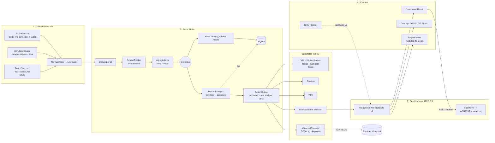

# Diseño – Fase 0 (propuesta para aprobación)

> Nombre de trabajo del producto: **LiveArena** (provisional, cámbialo cuando quieras).
> Prioridad acordada: **Minecraft interactivo funcionando lo antes posible**.

---

## 0. Qué aprendí de tus proyectos (MineLive / MineLiveLocalTest)

Lo que funciona bien y **conservo como comportamiento** (reimplementado desde cero en TypeScript, sin copiar código ni assets):

| Idea de tus proyectos | Cómo la llevo a la nueva app |
|---|---|
| `combos.js`: entregar **la diferencia** de cada racha al momento, cerrar por `repeatEnd` **o por timeout** (hay regalos que nunca mandan `repeatEnd`), recordar rachas cerradas para no duplicar ecos tardíos | `ComboTracker` con la misma estrategia incremental + tests de cada caso raro |
| `despachador.js`: likes por persona (cada N), metas de likes de sala que suben, cooldown de chat, tope de repeticiones por evento | Agregadores en el motor de reglas; el tope deja de **perder** acciones: el excedente se encola o se fusiona |
| `cola-rcon.js`: ~20 cmd/s, máx. 500 en cola | Cola **con prioridad** (regalo grande adelanta a 200 rosas), token bucket, métricas, y política de desborde explícita |
| Reglas con `cooldownGlobal/Persona`, `comandoAleatorio`, variables `{nick}`, `{usuario}` | Se mantienen, más **escape seguro** de nombres dentro de comandos (ver §7) |
| Marcador (victorias/derrotas/vidas), cronómetro, vigía de muertes, kit inicial, top donadores, top taps, mejor regalo, meta de likes | Todos entran como módulos/overlays |
| Plantillas (Asedio, Cubo, Supervivencia) | Sistema de **perfiles** importables/exportables por código (como en tus capturas) |
| Crear servidor local, activar RCON en `server.properties`, arrancar/parar Java | Asistente "Minecraft en 3 clics" (fase posterior a que el RCON ya funcione) |

Problemas que **corrijo**:
- Los modos Asedio, Cubo y Tótems dependen de plugins `.jar` (MiniLiveZombie, MiniLiveCubo, MiniLiveTotems) que se bajaban de una nube y **no están en los zips** → sin ellos esos modos no funcionan. Propuesta: plantillas que usan **solo comandos vanilla** (funcionan en cualquier servidor Vanilla/Paper/Spigot/Fabric) y, si lo quieres, más adelante un plugin Paper propio y open source.
- Contraseña RCON por defecto (`minelive`) en el preset → se genera aleatoria y se guarda cifrada.
- JS sin tipos, lógica de Electron mezclada con negocio en `main.js` (544 líneas) → núcleo independiente de Electron, testeable.
- Imágenes de regalos copiadas en `ui/gifts` → el catálogo (nombre, imagen, diamantes) se obtiene **del conector en vivo** y se cachea; no redistribuimos assets de TikTok.

De tus capturas tomo el **modelo de UX** (no marca ni diseño literal): Dashboard con estado/viewers/likes/actividad, **Acciones y Eventos separados** con perfiles, **Pantallas** (hasta 10 URLs de alertas), TTS con historial y reglas, Estudio de overlays por capas, integraciones (RCON Minecraft, OBS, VTube Studio, T.I.T.S., Streamer.bot, atajos de teclado).

---

## 1. Arquitectura



Principios:
- **El núcleo (`packages/core`) no conoce TikTok ni Electron.** Solo habla `LiveEvent` y `Action`.
- Cada proveedor implementa `LiveSource`; cada destino implementa `ActionExecutor`. Añadir Twitch u OBS = un archivo nuevo.
- Si el conector o el RCON caen, el resto sigue vivo (circuit breaker + reconexión), y el juego nunca se congela.

```ts
interface LiveSource {
  readonly id: string                       // 'tiktok' | 'simulator' | ...
  connect(target: string): Promise<void>
  disconnect(): Promise<void>
  status(): SourceStatus                    // idle|connecting|live|offline|error|backoff
  on(e: 'event', cb: (ev: LiveEvent) => void): Unsubscribe
  on(e: 'status', cb: (s: SourceStatus) => void): Unsubscribe
  getGiftCatalog?(): Promise<GiftInfo[]>
}

interface ActionExecutor {
  readonly channel: string                  // 'minecraft' | 'overlay' | 'tts' ...
  readonly rate: { perSecond: number; burst: number }
  execute(action: ResolvedAction, ctx: ExecContext): Promise<ExecResult>
  health(): ExecutorHealth
}
```

Reconexión TikTok: backoff exponencial con jitter (1 s → 2 → 4 … máx 60 s). Si TikTok responde "usuario no está en vivo" → estado `offline` y se reintenta cada 30 s (sin quemar el rate limit de Euler). Heartbeat: si no llega ningún evento ni `roomUser` en 45 s se verifica la conexión.

---

## 2. Esquema `LiveEvent`

```ts
type LiveEventType =
  | 'gift' | 'like' | 'chat' | 'follow' | 'share' | 'subscribe'
  | 'member_join' | 'room_stats' | 'live_end' | 'custom'

interface LiveUser {
  id: string               // userId estable de la plataforma
  uniqueId: string         // @handle
  nickname: string
  avatarUrl?: string
  badges?: { follower?: boolean; moderator?: boolean; subscriber?: boolean; topGifter?: number }
}

interface LiveEventBase<T extends LiveEventType, P> {
  v: 1
  id: string               // único: msgId de TikTok o uuid; clave de deduplicación
  type: T
  source: string           // 'tiktok' | 'simulator' | ...
  user: LiveUser | null    // null en eventos de sala
  ts: number               // epoch ms en que lo recibimos
  simulated?: boolean
  payload: P
}

type GiftPayload = {
  giftId: number; name: string; imageUrl?: string
  diamonds: number          // valor unitario
  count: number             // unidades NUEVAS de este evento (delta, nunca acumulado)
  streakTotal: number       // total acumulado de la racha hasta ahora
  streakId: string          // user + giftId + groupId
  phase: 'single' | 'streak' | 'streak_end' | 'streak_timeout'
}
type LikePayload   = { count: number; totalRoomLikes: number }
type ChatPayload   = { text: string; command?: { name: string; args: string[] } } // "!rojo 3" → {name:'rojo',args:['3']}
type StatsPayload  = { viewers: number; totalLikes?: number }
type SharePayload  = Record<string, never>
type FollowPayload = Record<string, never>
type SubscribePayload = { months?: number }

type LiveEvent =
  | LiveEventBase<'gift', GiftPayload>   | LiveEventBase<'like', LikePayload>
  | LiveEventBase<'chat', ChatPayload>   | LiveEventBase<'follow', FollowPayload>
  | LiveEventBase<'share', SharePayload> | LiveEventBase<'subscribe', SubscribePayload>
  | LiveEventBase<'member_join', {}>     | LiveEventBase<'room_stats', StatsPayload>
  | LiveEventBase<'live_end', {}>        | LiveEventBase<'custom', Record<string, unknown>>
```

Todos los tipos tienen su schema Zod en `packages/shared` (validación en el servidor y en el simulador).

### Decisión documentada: combos de regalos
**Procesamiento incremental sin duplicar** (no esperar a `repeatEnd`):
- Cada evento de racha emite un `gift` con `count = repeatCount - yaEntregado`. Así la latencia es <500 ms incluso en rachas de 100 toques.
- Cierre por `repeatEnd` o por timeout de 10 s (algunos regalos nunca envían `repeatEnd`).
- Rachas cerradas se recuerdan 60 s: los ecos tardíos solo aportan lo nuevo.
- Las reglas pueden elegir `"onStreak": "each" | "end"`: por defecto cada unidad cuenta; una regla de "alerta grande" puede pedir dispararse una sola vez al cerrar la racha con el total.

---

## 3. Protocolo WebSocket v1

Conexión: `ws://127.0.0.1:7420/ws?role=game|overlay|dashboard&token=…` (los overlays usan un token de solo lectura incrustado en su URL).

Sobre común:
```jsonc
{ "v": 1, "type": "action", "id": "a_01H…", "ts": 1731000000000, "payload": { … } }
```

| Dirección | `type` | Payload | Uso |
|---|---|---|---|
| C→S | `hello` | `{ role, client: "phaser-battle@1.0", subscribe: ["action:game.*","state:*"], screen?: 1 }` | Primer mensaje obligatorio |
| S→C | `welcome` | `{ protocol: 1, serverVersion, sessionId, state }` | Snapshot inicial (ranking, metas, equipos) |
| S→C | `event` | `LiveEvent` | Feeds, log, TTS de overlay |
| S→C | `action` | `{ kind: "game.battle.spawn", params, user, gift?, priority, intensity: 0..1 }` | Lo que el juego/overlay debe hacer |
| C→S | `ack` | `{ actionId, ok, error? }` | Métrica de latencia y reintento |
| S→C | `state` | `{ key: "leaderboard"\|"goal"\|"teams"\|"source"\|"minecraft", value }` | Estado incremental |
| C→S | `game.report` | `{ kind: "boss_defeated", data }` | El juego informa (p. ej. para sumar victoria) |
| ↔ | `ping` / `pong` | `{}` | Keep-alive cada 15 s |
| S→C | `error` | `{ code, message }` | Protocolo inválido, token, versión |

Reglas del protocolo: campos desconocidos se ignoran (compatibilidad hacia adelante); cambios incompatibles → `v: 2`. `intensity` (0–1, derivado de diamantes) permite que cualquier motor escale la espectacularidad sin conocer TikTok. Documentado en `docs/protocol.md` con ejemplos para Unity (C#) y Godot (GDScript).

---

## 4. Formato JSON de reglas (perfil)

Modelo de tus capturas: **Acciones** reutilizables + **Eventos** que las disparan, dentro de un **Perfil** exportable.

```jsonc
{
  "schema": 1,
  "id": "perfil-minecraft-caos",
  "name": "Minecraft Caos",
  "settings": { "minecraft": { "player": "Steve", "maxLiveMobs": 150 } },

  "actions": [
    {
      "id": "zombie",
      "name": "Zombie con tu nombre",
      "steps": [
        { "type": "minecraft.summon", "entity": "zombie", "at": "{player}",
          "nameTag": "{user.nickname}", "count": 1 },
        { "type": "minecraft.title", "target": "{player}", "actionbar": "🧟 {user.nickname} te envió un zombie" },
        { "type": "overlay.alert", "screen": 1, "template": "card",
          "text": "ZOMBIE", "color": "#8fd19e", "durationMs": 2500 }
      ]
    },
    {
      "id": "dragon",
      "name": "Dragón",
      "steps": [
        { "type": "minecraft.summon", "entity": "ender_dragon", "at": "{player}", "nameTag": "{user.nickname}" },
        { "type": "sound.play", "file": "epic.mp3", "volume": 0.8 },
        { "type": "overlay.alert", "screen": 1, "template": "big", "text": "¡DRAGÓN!", "durationMs": 5000 }
      ]
    },
    {
      "id": "aleatorio-malo",
      "name": "Sorpresa",
      "steps": [{ "type": "minecraft.random", "commands": [
        "effect give {player} minecraft:blindness 5 0",
        "execute at {player} run summon tnt ~ ~3 ~",
        "effect give {player} minecraft:levitation 3 1"
      ]}]
    },
    { "id": "unirse-rojo", "name": "Unirse a rojo",
      "steps": [{ "type": "game.battle.join", "team": "red" }] }
  ],

  "events": [
    { "id": "e1", "enabled": true,
      "trigger": { "type": "gift", "gift": { "name": "Rose" } },
      "actions": ["zombie"],
      "perUnit": true,                     // 10 rosas = 10 ejecuciones (multiplicador)
      "multiplier": 1,
      "maxPerEvent": 50, "overflow": "queue",   // queue | merge | drop
      "priority": "auto",                  // auto = según diamantes; o 0..100
      "cooldown": { "globalMs": 0, "perUserMs": 0 },
      "who": "anyone"                      // anyone | followers | subscribers | moderators | list
    },
    { "id": "e2", "trigger": { "type": "gift", "diamonds": { "min": 1000 } },
      "actions": ["dragon"], "onStreak": "each" },
    { "id": "e3", "trigger": { "type": "likes", "every": 50, "scope": "user" },
      "actions": ["zombie"] },
    { "id": "e4", "trigger": { "type": "likes", "goal": 1000, "step": 1000, "scope": "room" },
      "actions": ["aleatorio-malo"] },
    { "id": "e5", "trigger": { "type": "command", "name": "rojo", "aliases": ["red"] },
      "actions": ["unirse-rojo"], "cooldown": { "perUserMs": 10000 } },
    { "id": "e6", "trigger": { "type": "follow", "oncePerUser": true }, "actions": ["zombie"] },
    { "id": "e7", "trigger": { "type": "share" }, "actions": ["zombie"] }
  ],

  "screens": [{ "id": 1, "name": "Pantalla 1" }],
  "goals":   [{ "id": "g1", "metric": "diamonds", "target": 5000, "label": "Meta del día" }],
  "tts":     { "enabled": false, "who": "anyone", "minChars": 2, "maxChars": 200,
               "blocklist": ["…"], "commandPrefixIgnored": true }
}
```

Variables disponibles en cualquier texto/comando: `{player}`, `{user.nickname}`, `{user.uniqueId}`, `{gift.name}`, `{gift.count}`, `{gift.diamonds}`, `{gift.total}`, `{likes}`, `{command.args.0}`, `{random:1-10}`.

Tipos de paso (`steps[].type`) iniciales: `minecraft.command`, `minecraft.summon`, `minecraft.give`, `minecraft.effect`, `minecraft.title`, `minecraft.tp`, `minecraft.random`, `minecraft.kit`, `overlay.alert`, `sound.play`, `tts.say`, `scoreboard.add` (victorias/derrotas/vidas/cronómetro), `game.*` (lo maneja el módulo de juego), `wait` (ms). Más adelante: `obs.scene`, `keyboard.press`, `vts.hotkey`, `webhook`.

### Cola y rate limiting
- Un `ActionQueue` por **canal** (minecraft, overlay, tts, game) con su propio ritmo: Minecraft 20 cmd/s (burst 40); alertas de overlay 1 cada 1,2 s por pantalla (las demás se apilan); juego 30/s.
- Prioridad: `auto` = log₂(diamantes totales). Un Universe entra delante de 200 rosas pendientes, nunca se pierde.
- Desborde: `queue` (default, límite 2.000 por canal, después avisa), `merge` (fusiona N repeticiones: "×37" en la alerta y en Minecraft se reparte en lotes), `drop`.
- Protección del servidor de Minecraft: `maxLiveMobs` (cuenta entidades etiquetadas `lv` antes de invocar; si se supera, la acción espera en cola).

### Persistencia (SQLite + Drizzle)
Tablas: `sessions` (cada live), `users`, `user_session_totals` (diamantes, regalos, likes por usuario y live → ranking), `gift_log`, `goals`, `profiles` (JSON validado con Zod), `scoreboard` (victorias/derrotas/vidas), `settings`. Escritura agrupada cada 500 ms para aguantar ráfagas.

---

## 5. Estructura de carpetas

```
livearena/
├─ apps/
│  ├─ server/              # Fastify + ws + orquestación (puede correr sin Electron)
│  │  └─ src/{http,ws,sources,executors,minecraft,tts,db,index.ts}
│  ├─ dashboard/           # React + Vite + Tailwind (panel del streamer)
│  │  └─ src/{pages: Inicio, AccionesEventos, Minecraft, Overlays, TTS, Simulador, Ajustes}
│  ├─ overlays/            # Páginas ligeras para OBS: alerts, goal, top, feed, scoreboard, timer
│  ├─ game/                # Phaser 3: runtime + módulos de juego
│  │  └─ src/{runtime, modules/battle, modules/_template}
│  └─ desktop/             # Electron (fase 6): arranca server, ventana dashboard, safeStorage
├─ packages/
│  ├─ shared/              # Tipos + Zod: LiveEvent, protocolo WS, perfil de reglas
│  ├─ core/                # Dedup, ComboTracker, agregadores, motor de reglas, ActionQueue (sin I/O)
│  ├─ source-tiktok/       # ÚNICO paquete que importa tiktok-live-connector (dependencia aislada)
│  ├─ minecraft/           # Cliente RCON propio, cola, builders de comandos seguros, vigía de muertes
│  └─ ws-client/           # Cliente JS del protocolo (lo usan game, overlays y dashboard)
├─ profiles/               # Perfiles de ejemplo: minecraft-caos, minecraft-asedio-vanilla, battle
├─ docs/                   # protocol.md, rules.md, obs-setup.md, minecraft-setup.md, legal.md
├─ .env.example            # EULER_API_KEY=, TIKTOK_SESSION_ID= (opcional), PORT=7420
└─ pnpm-workspace.yaml
```

Stack: pnpm workspaces, TypeScript `strict`, Fastify, `ws`, Zod, Drizzle + better-sqlite3, pino (logs JSON), Vitest, React + Vite + Tailwind, Phaser 3, Electron (como en tus proyectos: necesitamos procesos locales para arrancar el servidor de Minecraft y leer `server.properties`; Tauri obligaría a un sidecar Node de todas formas).

---

## 6. Plan de fases (reordenado por tu prioridad: Minecraft)

| Fase | Entrega | Cómo lo pruebas |
|---|---|---|
| 1 | Conector TikTok + normalización + **simulador** + log en consola | `pnpm dev:server` + `pnpm sim burst --gifts 200` |
| 2 | Motor de reglas + colas + SQLite + tests (+ test de carga 100 ev/s) | `pnpm test` |
| **3** | **Minecraft interactivo end-to-end**: RCON con reconexión, cola, pasos `minecraft.*`, vigía de muertes, kit, perfil "Minecraft Caos" de ejemplo | Simulador o live real → mobs con el nombre del donador en tu mundo |
| 4 | Servidor WS + overlays (alertas por pantalla, meta, top, feed, marcador, cronómetro) | URLs en OBS / LIVE Studio |
| 5 | Dashboard: conexión, editor Acciones/Eventos, catálogo de regalos, **página Minecraft** (probar conexión, enviar comando), simulador, TTS, copiar URLs | Uso real sin tocar JSON |
| 6 | Juego "Batalla de equipos" (Phaser) | Overlay del juego con simulador |
| 7 | Pulido, Electron (instalador Windows), asistente "crear servidor Minecraft", README | Instalador `.exe` |

Al final de la **Fase 3** ya puedes hacer un live de Minecraft interactivo (configurando el perfil JSON); al final de la 5, sin tocar JSON.

---

## 7. Seguridad, legal y plataforma

- **API no oficial**: `tiktok-live-connector` usa ingeniería inversa y la firma de Euler Stream; puede romperse cuando TikTok cambie. Está aislado en `packages/source-tiktok`; si cae, el simulador y el resto siguen funcionando. Documentado en `docs/legal.md`.
- **Secretos**: Euler API key, session id y contraseña RCON en `.env` (dev) o cifrados con `safeStorage` de Electron; nunca en perfiles exportados.
- **Servidor local**: escucha solo en `127.0.0.1`, valida cabecera `Host`/`Origin` (contra DNS rebinding) y exige token para la API que modifica cosas. Los overlays usan un token de solo lectura.
- **Inyección en comandos de Minecraft**: los nicknames de TikTok pueden traer comillas, `{}`, `@`, saltos de línea. Los comandos se construyen con builders que escapan JSON/NBT y eliminan caracteres de control; `{player}` se valida contra `^[A-Za-z0-9_]{3,16}$`.
- **Consentimiento**: nada actúa sobre la cuenta de TikTok del streamer (solo lectura del live). Los ejecutores locales potentes (teclas, Streamer.bot) vienen apagados y piden activación explícita.
- **Sin apuestas**: sin premios en dinero real, sin sorteos pagados, sin "cajas" con recompensas canjeables. Los aleatorios solo afectan al juego.
- **Políticas TikTok LIVE** (revisa la versión vigente antes de lanzar): Normas de la comunidad, Directrices de monetización de LIVE y Política de Regalos. En resumen: no apuestas ni juegos de azar con regalos, no prometer recompensas fuera de la plataforma a cambio de regalos, no pedir regalos de forma engañosa o insistente, y el contenido del juego debe cumplir las normas (violencia gráfica, etc.). El minijuego no debe hacer que el live parezca contenido no original o pregrabado.
- **Minecraft**: el EULA de Mojang lo acepta el usuario explícitamente al crear un servidor (no se acepta en su nombre).
