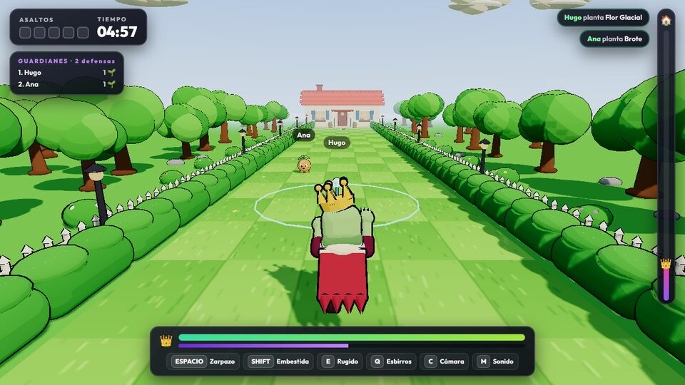
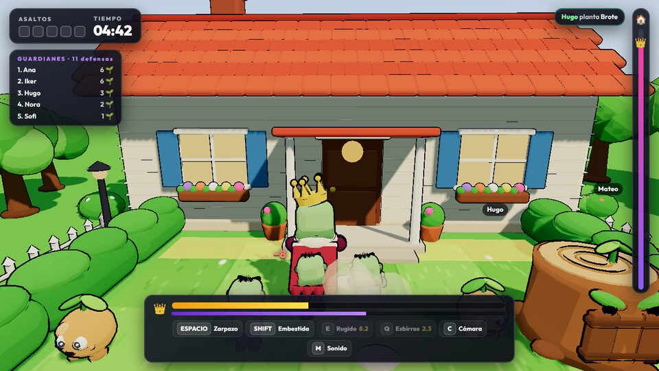
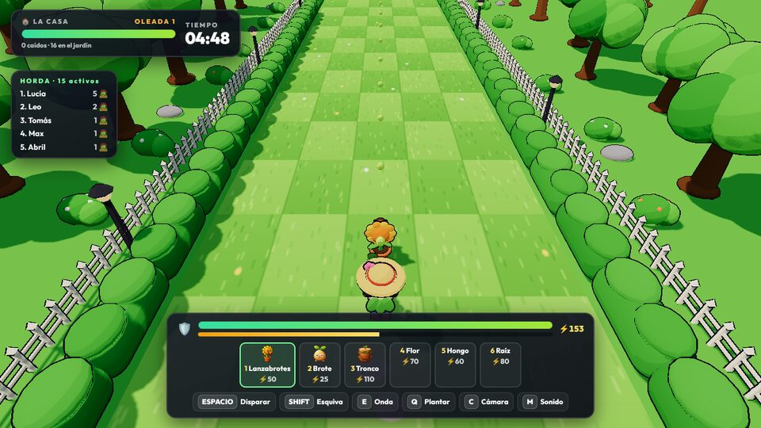
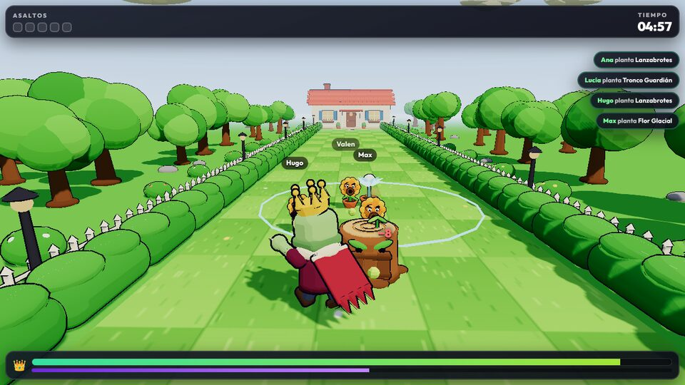

# LAST HOUSE 2.0 — auditoría visual, comparativa de motor y propuesta

Fase 7 del roadmap v14. **Solo análisis y propuesta: no se ha tocado el juego.** Nada se migra ni se rehace sin tu
visto bueno; la fase 8 (prueba visual) arranca cuando digas «sí, ese es el camino».

Capturas tomadas del juego tal como está (`/juego/lasthouse?demo=1`, Chromium por software en el servidor de pruebas;
los FPS de ese entorno no sirven como medida, ver «Rendimiento»):

| Invasión, inicio | Invasión, llegando a la casa | Defensa | Vertical 9:16 |
|---|---|---|---|
|  |  |  |  |

## 1. Auditoría (qué hay y qué falla)

Cómo está hecho hoy (`apps/dashboard/src/game/lasthouse`):
- **Modelos**: todos los personajes se componen en código con primitivas (esferas, cajas y cilindros) en
  `models.ts`; material «toon» con degradado de 3 tonos y contorno por casco invertido. Sin texturas.
- **Animación**: procedural (senos sobre grupos: balanceo de cabeza, brazos que suben y bajan, escala al golpear).
  No hay esqueleto, ni curvas, ni mezcla entre animaciones.
- **Escenario**: `scenery.ts` repite en bucles el mismo seto, la misma valla, el mismo árbol y la misma farola; césped de
  cuadros plano.
- **Render**: Three.js r170, sombras PCF suaves, ACES, bloom (`UnrealBloomPass`) a 256 px. Sin oclusión ambiental, sin
  niebla de profundidad, sin LOD ni instancing.

| Aspecto | Estado | Problema concreto |
|---|---|---|
| Personajes | Simples, de juguete | Siluetas de bloques: el Rey es un cubo verde con capa plana; los zombis comparten cuerpo y solo cambian de color; las plantas son esferas sobre un tiesto. Sin cara expresiva (ojos punto). |
| Personalidad | Baja | Ninguna pose propia: todos se mueven igual. No hay anticipación ni «squash & stretch» en los golpes. |
| Animación | Rígida | Piezas que giran sobre un eje fijo; sin peso al andar, sin transiciones (de andar a atacar salta), sin movimiento secundario (hojas, capa, corona). |
| Vegetación | Clonada | Setos idénticos en fila, árboles con la misma copa a la misma distancia, valla perfecta. Se nota el patrón a simple vista. |
| Suelo | Plano | Cuadros de dos verdes sin relieve, sin hierba, sin caminos gastados, sin bordes. |
| Materiales | Planos | Un color por pieza; no hay rugosidad, brillo, ni variación. La casa es la pieza con más detalle y aun así es de caja. |
| Iluminación | Correcta pero sosa | Un sol y una luz de cielo; sin luz de contorno que separe a los personajes del fondo verde (se funden). |
| Sombras | Duras en el pie | Sombras proyectadas sin oclusión de contacto: los personajes «flotan». |
| Composición | Repetitiva | Pasillo recto simétrico con la casa al fondo; poco primer plano y nada que enmarque. En vertical, el HUD tapa un tercio. |
| Lectura en directo | Buena | Los carriles, los nombres y el HUD se entienden: esto **hay que conservarlo**. |

Lo que funciona y no se toca: mecánicas (`sim.ts`, `defense.ts`), director y votos (`director.ts`), eventos del
directo, HUD y audio. La parte débil es solo la representación (`models.ts`, `scenery.ts`, `view.ts`).

## 2. Comparativa de motor

Criterios: rendimiento en un PC de gama media mientras se emite, si va en navegador o ejecutable, captura en OBS /
TikTok LIVE Studio, coste, tiempo y encaje con LiveArena (los eventos del directo ya llegan por WebSocket a la app).

| | Three.js (actual) | Babylon.js | PlayCanvas | Godot 4 | Unity URP |
|---|---|---|---|---|---|
| Dónde corre | Navegador / app | Navegador / app | Navegador / app | Ejecutable (o web con limitaciones) | Ejecutable (web pesada) |
| Captura en OBS / LIVE Studio | Fuente de navegador o ventana: ya funciona | Igual | Igual | Captura de ventana | Captura de ventana |
| Animación con esqueleto | Sí (glTF + AnimationMixer) | Sí, más completa | Sí | Sí, muy buena | Sí, la mejor |
| Postproceso (AO, contorno, bloom) | Con pases (SSAO/GTAO, Outline) | Integrado | Integrado | Integrado | Integrado |
| Rendimiento gama media | Bueno si se cuidan draw calls | Bueno | Muy bueno | Muy bueno | Muy bueno |
| Integración con LiveArena | Total (mismo código, mismo protocolo) | Alta (JS) | Alta (JS) | Hay que hacer cliente WebSocket | Hay que hacer cliente WebSocket |
| Coste | Gratis | Gratis | Gratis (editor en la nube con límites) | Gratis | Licencia según ingresos |
| Tiempo de migración | 0 | Reescribir la vista (~2–3 semanas) | Reescribir la vista + editor | Reescribir todo el juego | Reescribir todo el juego + instalador |
| Riesgo | Bajo | Medio | Medio | Alto | Alto |

**Recomendación: seguir con Three.js** y subir la calidad con modelos glTF con esqueleto (hechos en Blender, con
animaciones por curvas), oclusión ambiental (GTAO), luz de contorno y LOD/instancing. El salto visual que pides lo
dan sobre todo los modelos, las animaciones y la iluminación, no el motor; cambiar de motor costaría semanas sin
ganar nada que el directo note, y obligaría a capturar una ventana aparte en vez de un overlay. Si en la prueba visual
el rendimiento no llega, la alternativa de menor riesgo es Babylon.js (también JS, mismo protocolo).

## 3. Arquitectura en tres capas (para poder cambiar de motor sin tocar mecánicas)

```
simulación (sim.ts, defense.ts, director.ts)  ── estado puro, sin THREE ──┐
                                                                          │ instantánea por tick (posiciones, estados,
comunicación (LastHouse.tsx + WebSocket de LiveArena)                     │ eventos: golpe, muerte, habilidad…)
                                                                          ▼
representación (view.ts → nuevo «renderer» con interfaz fija)
```
- La simulación ya no importa nada de Three.js salvo tipos menores: se terminará de separar.
- La vista recibirá solo la instantánea y una cola de eventos (`hit`, `die`, `cast`, `plant`…), y elegirá la animación.
  Así otra vista (Babylon, Godot vía WebSocket) podría sustituirla sin tocar reglas ni el director.

## 4. Propuesta de estilo propio («jardín encantado al atardecer»)

Identidad original: nada de siluetas, nombres ni paletas de otros juegos. Referencia de *calidad* (acabado, legibilidad
y animación con personalidad), no de diseño.

- **Formas**: siluetas con una idea clara cada una. El Rey de la Horda, grande y encorvado, con brazos largos, capa
  rasgada con movimiento propio y corona ladeada. Los zombis tienen tres complexiones (flaco, gordo, bajito) y ropa
  distinta. Las plantas son criaturas con cara: el Lanzabrotes con «boca» de vaina que se infla antes de disparar.
- **Paleta**: verdes saturados en el jardín y morados apagados en la horda, para que se separen. Acentos cálidos
  (oro, naranja) solo en lo importante: corona, proyectiles y la casa.
  - Jardín: `#4FB548` / `#2E7D3A` / `#A8E06A`.
  - Horda: `#7A5C8E` / `#4B3A5E` / `#B5E37A` (piel).
  - Acentos: `#F5C63A`, `#FF8A3D`.
- **Materiales PBR estilizados**: color con degradado pintado a mano en la textura (no un color plano), rugosidad
  alta y algo de brillo en hojas mojadas, metal y cristal de la casa.
- **Iluminación**: sol bajo y cálido con luz de contorno fría desde atrás (separa al personaje del fondo), cielo con
  degradado, oclusión ambiental y sombra de contacto bajo los pies. Niebla suave de profundidad para dar escala.
- **Escenario**: setos con variaciones (3–4 modelos, rotados y escalados), flores y hierba con instancing que se mueven
  con el viento, caminos de tierra gastados por los carriles, la valla rota en algunos tramos y objetos que cuentan la
  historia (macetas caídas, juguetes, una regadera).
- **Animación**: esqueleto + curvas (reposo, andar, ataque, carga, impacto, daño, celebración, derrota) con
  anticipación y rebote; movimiento secundario por física simple (capa, hojas, corona).

## 5. Fase 8: qué se entregará para validar

1. Un invasor (zombi base), el **Lanzabrotes** y un fragmento del jardín (un carril con seto, valla, flores y un trozo
   de la casa) al nivel final, dentro del juego real.
2. Comparación lado a lado antes/después con la misma cámara, y medida de FPS en un PC de gama media (la mediré en
   el cliente de Windows de la release; el servidor de pruebas no tiene GPU).
3. **Punto de parada**: me dices si es el camino. Solo entonces la fase 9 aplica el estilo a todo (con LOD,
   instancing, atlas de texturas y ajuste automático de calidad), sin tocar mecánicas ni votos.
